# Servicios y procesos de DomusCond

DomusCond vende la operación diaria de un condominio como un solo servicio. El administrador, la caseta, el contador, el residente y el proveedor trabajan sobre los mismos hechos: quién vive, quién entró, qué se debe y qué decidió la asamblea.

Este documento recorre cada servicio desde que una persona entra hasta que el hecho queda registrado. El detalle de estados, excepciones y pantallas está en [BUSINESS-PROCESSES.md](BUSINESS-PROCESSES.md).

## Cómo leer un diagrama

Cada flecha es un paso que alguien hace o que la plataforma deja asentado. El rombo es una decisión. El proceso termina cuando la otra parte ya puede ver el resultado.

## La oferta

| Servicio | A quién le ahorra trabajo | Qué queda demostrado |
| --- | --- | --- |
| Acceso y sesión | A cada rol, para no compartir una cuenta | Quién entró y que el correo es suyo |
| Alta del condominio | Al administrador nuevo | Torres, unidades y primeras invitaciones |
| Comunidad | A administración y a caseta | Residente, personal y proveedor ligados a una unidad o a un rol |
| Caseta y QR | Al guardia y al residente | Entrada y salida de la visita, una sola vez |
| Paquetería | A caseta | El residente sabe que su paquete llegó |
| Rondas y cámaras | A vigilancia | Bitácora del recorrido y plano con la fuente de video |
| Cuotas y multas | Al contador y al residente | Un solo estado de cuenta y un folio de recibo |
| Incidencias y proveedores | A mantenimiento, limpieza y proveedores | Quién tiene la orden y cuándo se citó |
| Estacionamiento | A administración | Cajón y placa del residente, aparte de la visita |
| Áreas y amenidades | Al residente | Solicitud, aprobación y calendario |
| Gobierno del condominio | A la mesa directiva | Aviso, voto por unidad y acta |
| Expediente | A administración | Reglamento, contrato e identificación publicados |
| Suscripción de la plataforma | Al operador del SaaS | Plan, acceso y condonación, separados de la cuota |

La cuota del residente y la suscripción del administrador son dos dineros. No se mezclan.

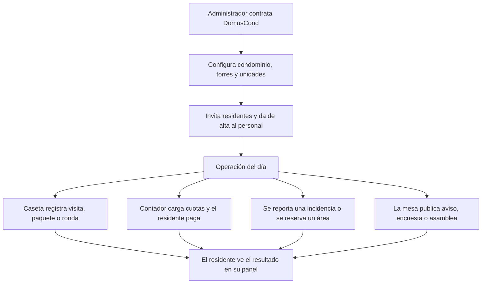

## 1. Acceso y sesión

**Qué se vende.** Una puerta de entrada por rol. El residente no ve la caseta. El guardia no ve la cobranza de la plataforma.

**Valor.** Se evita la cuenta compartida del comité. Si la persona olvida la contraseña, recupera el acceso sin llamar a soporte.

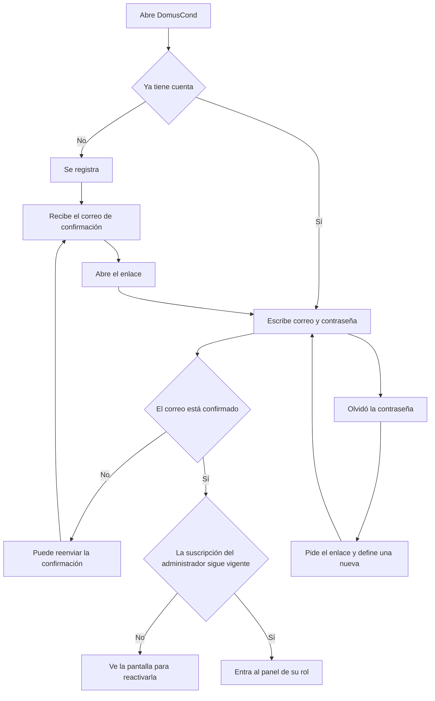

El personal que crea un administrador autenticado queda confirmado y no espera correo. El registro público sí espera la confirmación antes de entrar.

## 2. Alta del administrador y suscripción

**Qué se vende.** El arranque del cliente: una cuenta de administrador y un plan por unidad.

**Valor.** El edificio empieza sin que el operador del SaaS capture a mano cada torre. Si el pago de la plataforma se atrasa, el acceso se corta y se vuelve a abrir al condonar, sin tocar las cuotas de los residentes.

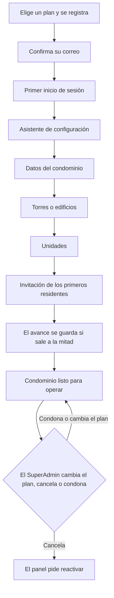

El cobro con tarjeta de esta suscripción ya opera en el sandbox de OpenPay. Cambiar el plan, cancelar o condonar no exige un cargo. El comercio de producción sigue fuera.

## 3. Puesta en marcha del condominio

**Qué se vende.** El edificio queda descrito como lo recorre la gente: condominio, torre, unidad, residente.

**Valor.** Administración deja de llevar el padrón en una hoja. Caseta, cobranza y asamblea usan la misma unidad.

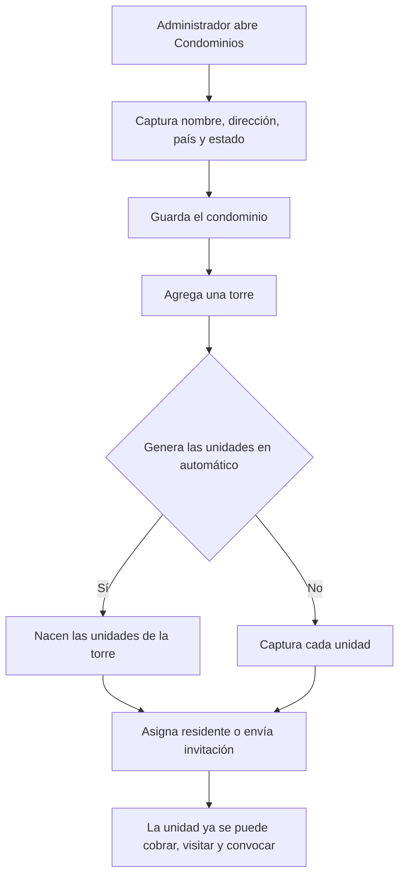

El administrador puede corregir después el nombre y la dirección. El país y el estado salen del catálogo. Si el país tiene estados, hay que elegir uno.

## 4. Comunidad: residentes, personal y proveedores

**Qué se vende.** El padrón vivo del edificio y el equipo que lo opera.

**Valor.** Un aviso, una multa o un paquete llegan a la persona de esa unidad. Vigilancia, mantenimiento y limpieza entran con su propio panel. El proveedor solo ve lo que le encargan.

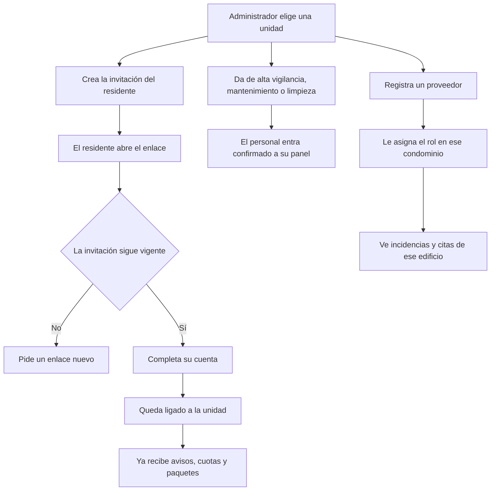

Sin ese vínculo, el residente existe en el padrón y no recibe las notificaciones. El formulario de personal ofrece mantenimiento, vigilancia y limpieza. El proveedor se incorpora por su propio rol.

## 5. Caseta y visitas con QR

**Qué se vende.** El control de quién entra, sin una libreta y sin que el guardia pregunte el nombre en voz alta.

**Valor.** El residente autoriza antes. El visitante trae un código. Caseta registra la entrada y la salida. El residente recibe el aviso de que su visita llegó. Un código de otro edificio no revela si existe.

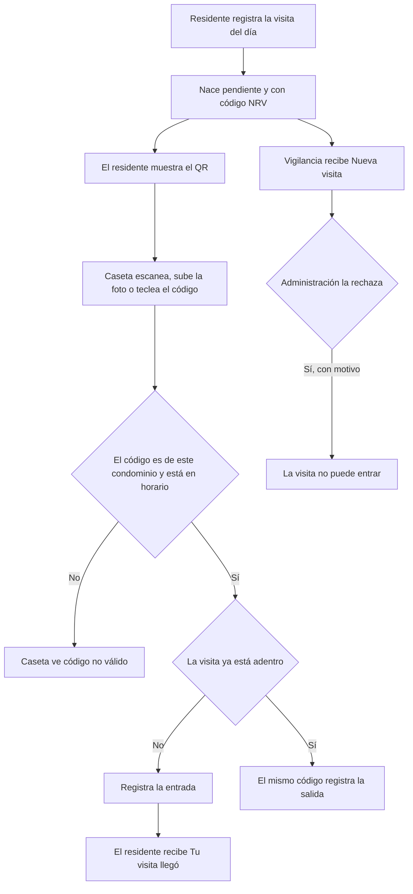

El pase abre desde dos horas antes de la llegada prevista hasta una hora después de la salida prevista. Si no hay hora de salida, queda abierto trece horas desde la llegada. Sirve para una sola entrada. Rechazada, cancelada o finalizada, no entra.

Estados de la visita: pendiente, aprobada, rechazada, adentro y finalizada. La entrada se puede tomar desde pendiente o aprobada. La salida solo desde adentro.

## 6. Paquetería

**Qué se vende.** La recepción de paquetes en caseta, con aviso al departamento correcto.

**Valor.** El residente no baja a preguntar. Caseta no depende de un chat para avisar.

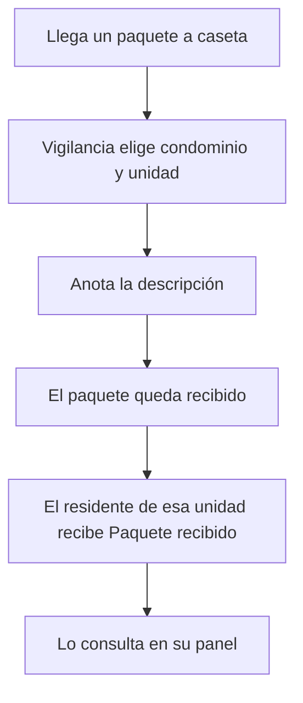

El servicio deja constancia de la recepción. No acusa la entrega al repartidor ni se conecta con la paquetería.

## 7. Rondas y cámaras

**Qué se vende.** La evidencia de que el recorrido se hizo y un plano para ubicar la cámara.

**Valor.** La bitácora de rondas no se mezcla con el libro de visitas. El comité ve el plano. Vigilancia abre la fuente de video que administración ya configuró.

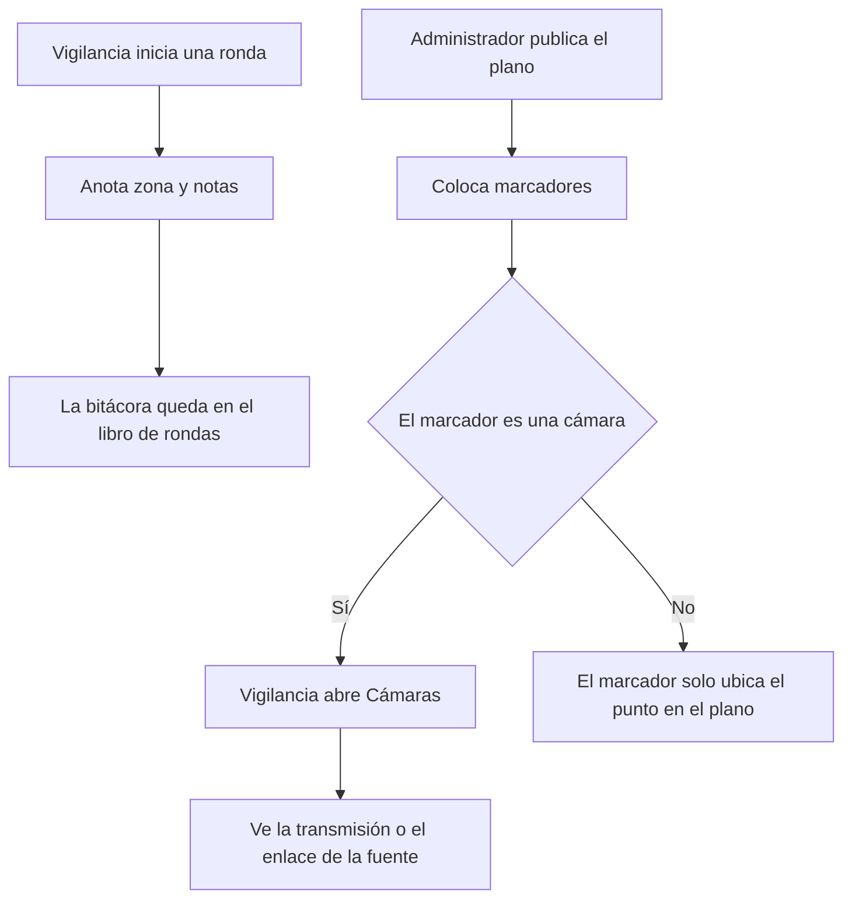

La ronda no trae recorrido GPS ni checklist de puestos. DomusCond no graba video: reproduce el URL que el condominio ya tiene.

## 8. Cuotas, recibos y multas

**Qué se vende.** El estado de cuenta de la unidad, con recibo foliado, y la multa dentro de ese mismo estado.

**Valor.** El residente ve un solo saldo. El contador no lleva una libreta paralela para las multas. El folio existe desde que se registra el pago.

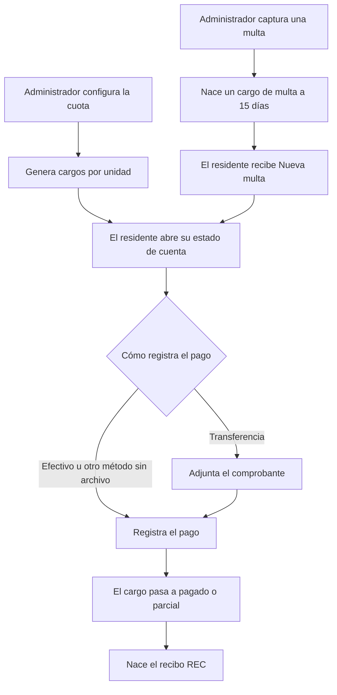

Administración puede verificar después el pago. El folio no espera esa verificación. No hay CFDI, domiciliación ni cargo con tarjeta del residente hacia la cuota. El pago es un registro de la administración del edificio.

## 9. Incidencias y agenda de proveedores

**Qué se vende.** Una orden de trabajo con responsable, y una cita cuando el trabajo es de un externo.

**Valor.** El residente reporta una vez. Mantenimiento, limpieza o el proveedor ven la orden en su panel. El comité deja de perseguir el avance por mensajes.

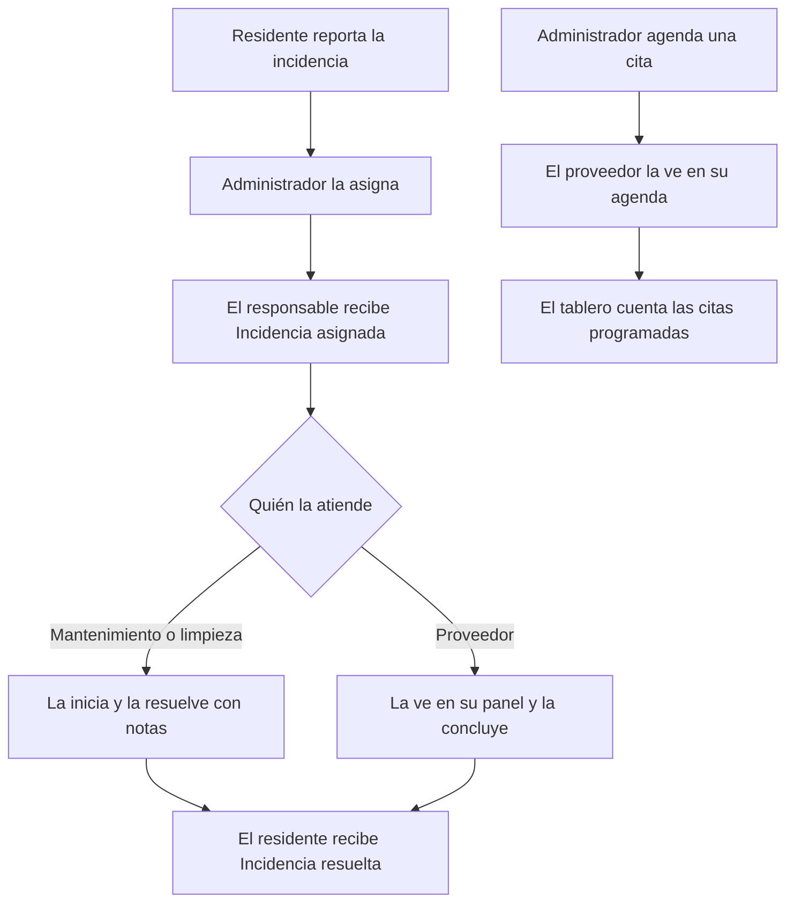

La cita del proveedor no es una visita de caseta. Vive en la agenda y no cambia el libro de accesos.

## 10. Estacionamiento

**Qué se vende.** El padrón de cajones y placas de quien vive ahí.

**Valor.** Administración sabe qué placa corresponde a qué cajón. La placa de un visitante no se convierte en vehículo del residente.

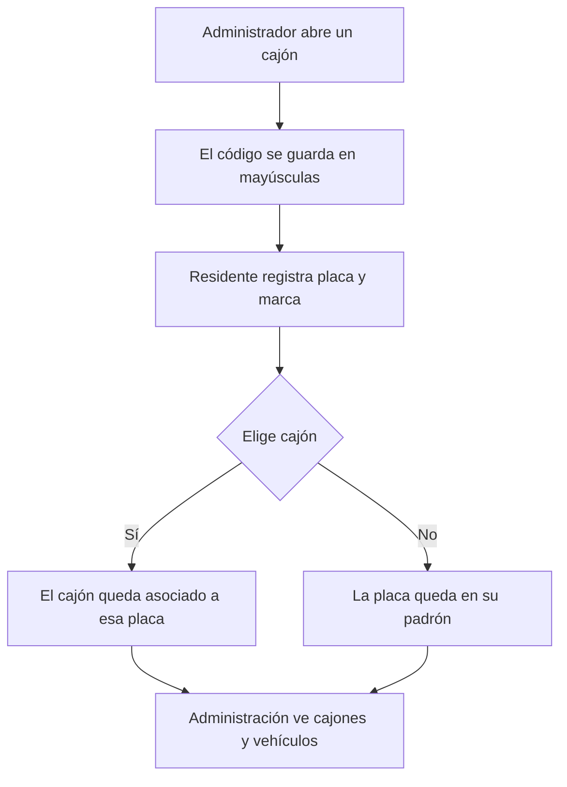

## 11. Áreas comunes y amenidades

**Qué se vende.** Dos calendarios distintos: el área del edificio y la amenidad con cupo.

**Valor.** El residente pide la fecha y el motivo. Administración aprueba. Lo inactivo deja de ofrecerse sin borrarlo del historial.

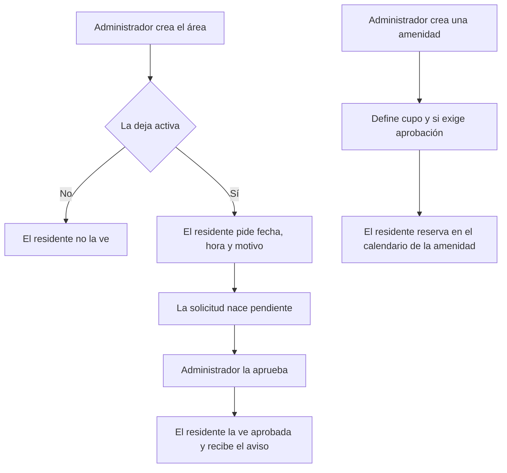

Reservar el salón no es reservar la amenidad. Cada una conserva su propio registro.

## 12. Gobierno del condominio

**Qué se vende.** El canal oficial del comité: aviso, encuesta y asamblea con acta.

**Valor.** El voto es por unidad. La invitación a la asamblea queda enviada. El acta se puede leer sin esperar a reconstruirla en un documento aparte.

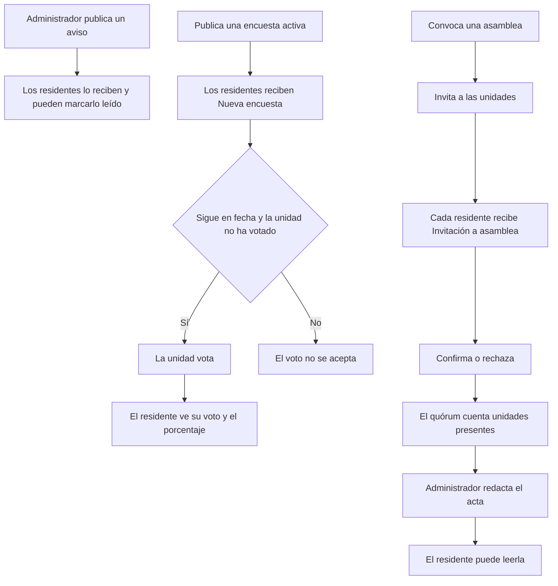

La encuesta admite un voto por unidad, salvo que se haya permitido más de uno. La asamblea no invita sola: hay que recorrer las unidades.

## 13. Expediente del condominio

**Qué se vende.** El archivo que el residente puede consultar sin pedir una copia por correo.

**Valor.** Reglamento, contrato, identificación o poder quedan publicados con un tipo. No se confunden con el comprobante de un pago ni con el acta de la asamblea.

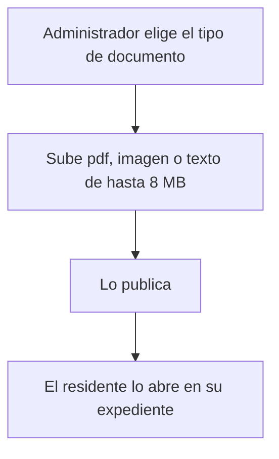

Tipos: contrato, factura, recibo, identificación, poder, reglamento, acta y otro.

## 14. Tablero del contador

**Qué se vende.** La lectura de la cobranza y de la operación, para el contador y para el administrador.

**Valor.** El comité ve cargos, pagos y actividad reciente sin exportar una hoja para la junta de la semana.

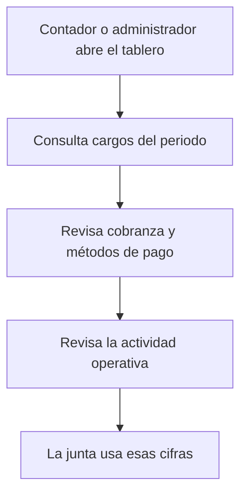

El tablero no es un libro mayor, no concilia bancos y no exporta un archivo fiscal.

## Qué se puede prometer hoy

Se puede prometer la operación del edificio: padrón, caseta, paquete, ronda, cuota, multa, incidencia, cita, cajón, reserva, aviso, voto, acta y expediente.

Conviene decir con claridad lo que el piloto todavía no cierra, para no venderlo como incluido:

- El comercio de producción de OpenPay. El sandbox de la suscripción de la plataforma ya cobra.
- El pago con tarjeta del residente hacia su cuota.
- CFDI, conciliación bancaria y libro mayor.
- Recorrido GPS de la ronda y grabación propia de video.
- Acuse del paquete frente al repartidor.

Esos límites protegen la venta. El valor que ya se entrega es la operación completa del condominio en un solo lugar, con cada rol viendo solo su trabajo.
